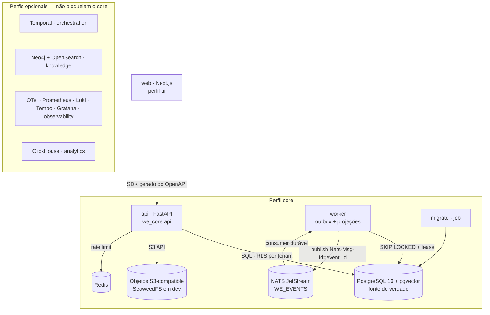

# Vista de contentores (C4 nível 2)

| Contentor | Imagem | Utilizador | Notas |
|---|---|---|---|
| api / worker / migrate / dev-idp | `we/core` (python:3.13-slim, multi-stage, sem pip em runtime) | 10001 | `read_only`, `cap_drop: ALL`, `no-new-privileges` |
| web | `we/web` (node:22-alpine, Next standalone) | node (1000) | Token lido no servidor; CSP restritiva |
| postgres | `pgvector/pgvector:pg16` | — | `--data-checksums`, SCRAM |
| nats | `nats:2.10-alpine` | — | JetStream em ficheiro |
| objectstore | `chrislusf/seaweedfs:3.97` | — | Substitui o MinIO (ADR-0004) |

Todas as portas estão ligadas a `127.0.0.1`. Os perfis estão definidos em `infra/compose/compose.yaml`.

## Mapa de camadas lógicas → módulos

| Camada lógica (constitucional) | Módulo `we_core` | Estado |
|---|---|---|
| 1 Foundation | `db`, `migrate`, `common`, `observability`, `platform` | Implementado |
| 2 Governance | `governance`, `identity.authz`, `audit` | Implementado (HITL, SoD, ABAC deny) |
| 3 TME-WE Cognitive Kernel | `kernel` | ENTITY, ROLE, RELATION, CONTEXT_FRAME |
| 4 Relational Graph Engine | `kernel.relations` (Neo4j = projeção futura) | Parcial |
| 5 Procedural Runtime | `workflow` (schema) | Schema e versionamento; motor PENDENTE |
| 6 Communication Runtime | `communication` (schema, envio bloqueado) | Schema |
| 7 Document & Evidence | `evidence` | Implementado |
| 8 Obligation & Compliance | `obligation` (catálogo com validação externa obrigatória) | Schema |
| 9 Intelligence & Research | `knowledge`, `ai` | Importador, pgvector, AI gateway |
| 10 Opportunity Engine | `intelligence` | SIGNAL → OPPORTUNITY |
| 11 Execution Layer | `governance.execute` (recorded_only) | Sem efeitos externos |
| 12 Network & Connectors | `connectors`, `legacy` | ACL e staging; conectores PENDENTES |
