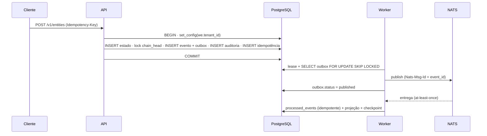

# Modelo de dados e de eventos

## Conceitos canónicos → tabelas

| Conceito | Tabela | Mutabilidade |
|---|---|---|
| TENANT / ORGANIZATION | `platform.tenants`, `platform.organizations` | estado |
| ACTOR / MEMBERSHIP / POLICY | `iam.actors`, `iam.memberships`, `iam.policies` | política: versões imutáveis |
| CAPABILITY | `platform.capabilities` (catálogo global) | catálogo |
| ENTITY / ROLE / RELATION | `kernel.entities`, `kernel.entity_roles`, `kernel.relations` | estado + evento por alteração |
| CONTEXT_FRAME | `kernel.context_frames` | **append-only**; nova versão em vez de alteração |
| EVENT | `event_store.events` | **append-only** + cadeia de hash |
| AUDIT_LOG | `audit.audit_log` | **append-only** + cadeia de hash |
| EVIDENCE | `evidence.evidence`, `custody_events`, `links` | **append-only**; objeto imutável |
| DECISION | `governance.decisions`, `governance.approvals` | máquina de estados reforçada por trigger; aprovações append-only |
| AI_TRACE | `ai.ai_traces` | append-only |
| SIGNAL / OPPORTUNITY | `intelligence.signals`, `intelligence.opportunities` | estado |
| KNOWLEDGE_NODE | `knowledge.sources`, `knowledge.nodes`, `knowledge.chunks` | fontes append-only |
| WORKFLOW_DEFINITION / INSTANCE | `workflow.definitions` (imutável), `instances`, `step_log` | definição fixada por instância |
| OBLIGATION | `obligation.rule_catalog` (global, validação externa), `obligation.obligations` | — |
| COMMUNICATION_EVENT / INTERACTION | `communication.*` | append-only; envio bloqueado |
| SOURCE_SYSTEM / IMPORT_BATCH / MAPPING_RULE / RECONCILIATION / LEGACY_ID_MAP | `legacy.*` | snapshots e mapeamentos append-only |

## Envelope de evento (v1)

`contracts/jsonschema/event-envelope.v1.schema.json`: `event_id` (UUIDv7), `event_type`, `schema_version`,
`tenant_id`, `organization_id`, `aggregate_type`, `aggregate_id`, `aggregate_version`, `context_frame_id`,
`actor_id`, `actor_type`, `occurred_at`, `recorded_at`, `correlation_id`, `causation_id`, `trace_id`,
`idempotency_key`, `chain_seq`, `classification`, `payload`, `metadata`, `previous_hash`, `event_hash`.

## Catálogo de eventos

29 pares tipo/versão em `contracts/jsonschema/events/` (28 tipos; `kernel.entity_created` tem v1 e v2).
Contrato de transporte em `contracts/asyncapi/we-events.v1.json`. Regras: payload fechado
(`additionalProperties: false`), sem PII (ADR-0013) e evolução apenas aditiva (há teste).

## Ordenação e consistência
- Ordem garantida por tenant (`chain_seq`) e por agregado (`aggregate_version`). Não há relógio global.
- Projeções com checkpoint por `(tenant, projeção)` e replay determinístico (rebuild duplo + digest).
