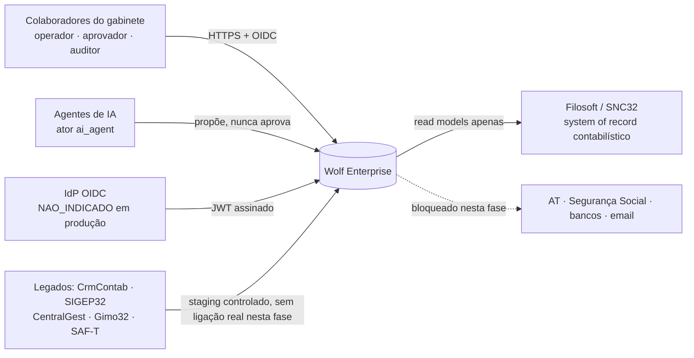

# Contexto do sistema (C4 nível 1)

A WE é um **Sistema Operacional Cognitivo Organizacional Contextual**. Não é um ERP, CRM, BPM ou DMS. Organiza
entidades, relações, contexto, eventos, evidências e decisões para reduzir a entropia organizacional de um
gabinete de contabilidade e dos seus clientes.

| Fronteira | Estado nesta entrega |
|---|---|
| Utilizadores humanos | API e consola web mínima (só leitura, mais a verificação de evidências) |
| IdP | Emissor de desenvolvimento local. **IdP produtivo NAO_INDICADO** (ADR-0006) |
| Filosoft | Mantém-se system of record (ADR-0012). Integração de read models PENDENTE |
| Legados | Registo de sistemas, staging, importador de conhecimento provado com dados sintéticos |
| Entidades oficiais (AT/SS) | **Sem integração**: submissões, faturação certificada e XAdES excluídas desta missão |
